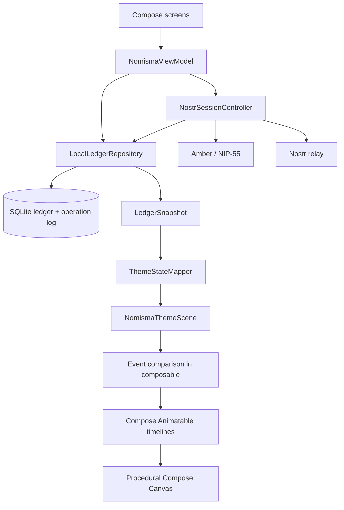
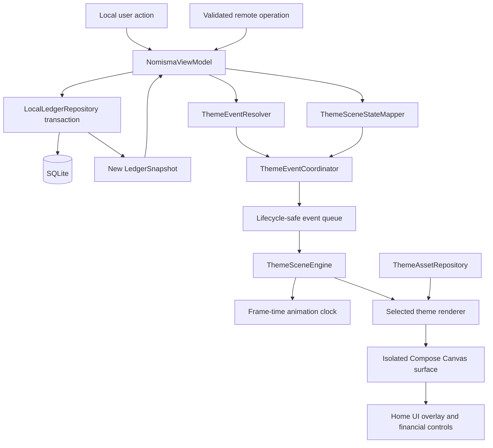
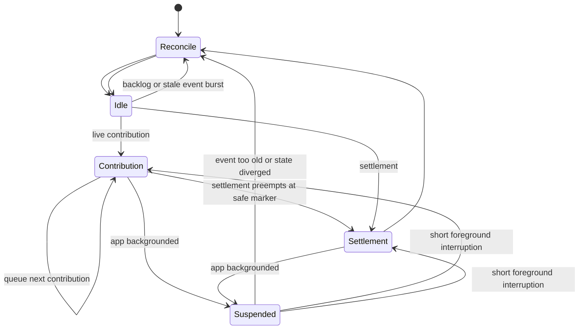

# Nomisma Theme Engine Proposal

Status: architecture proposal only. No production renderer migration is implemented by this document.

## 1. Executive decision

Nomisma should keep Jetpack Compose for application UI and use an isolated Compose Canvas scene surface for theme rendering. The production direction should be a 2.5D hybrid renderer built from layered painterly raster assets, lightweight bone transforms, deterministic particles, simple physics curves, and optional AGSL material effects on supported devices.

Full real-time 3D and a game engine are not justified. They would increase APK size, battery usage, device variance, and maintenance cost without improving the financial product. The current procedural Canvas renderer remains useful as a fallback and as a prototype reference, but it cannot reach the requested painterly quality by adding more vector paths.

The financial, persistence, Nostr, and synchronization layers should remain unchanged except for a narrow presentation-event adapter at the ViewModel boundary.

## 2. Repository audit

### Platform and build

- Single Android application module.
- Kotlin `2.4.20` with Jetpack Compose.
- Android Gradle Plugin `9.4.1`, Gradle `9.7.1`.
- `minSdk 26`, `targetSdk 37`, `compileSdk 37`.
- No external game, animation, or image-loading engine.
- The existing debug build and 45 unit tests pass.

### Application UI

`NomismaApp.kt` owns the Compose application shell and is currently a large, single-file UI implementation. It contains:

- first-run onboarding;
- five bottom-navigation destinations: Home, Insights, Settle, History, and Settings;
- expense creation and editing dialogs;
- synchronization and pairing settings;
- financial analytics and filters;
- the Home hierarchy: ledger header, sync state, net balance, theme selector, theme scene, cycle metrics, settlement action, and recent expenses.

The current Home composition already matches the required product hierarchy. It does not need a navigation redesign for the theme milestone.

### Financial and persistence layers

The domain layer is independent from rendering and already provides:

- expenses, participants, categories, tags, balances, analytics, and settlement cycles;
- validation policies and normalized minor-unit amounts;
- deterministic two-participant balance calculation;
- immutable `LedgerSnapshot` values;
- a local operation model with per-author sequencing.

`LocalLedgerRepository` is the local authority. It uses SQLite, applies mutations transactionally, creates outbox operations, validates inbound operations, deduplicates transport events, defers sequence gaps, and materializes a new snapshot after changes.

This layer should remain unchanged by the rendering work.

### Nostr and synchronization

The synchronization layer is also separate from rendering:

- Amber/NIP-55 supplies identity, signing, encryption, and decryption;
- NIP-59 gift wrap is the default transport;
- NIP-44 v2 direct transport remains available for controlled tests;
- inbound events are structurally and cryptographically validated before repository application;
- the relay client handles acknowledgements, EOSE, reconnect backoff, and message limits;
- a backlog emits one aggregate remote-change signal after EOSE instead of one UI update per historical event.

This is the correct foundation. Theme code must continue to react only after the repository has accepted and persisted a change.

### Current theme system

The current theme implementation already has several sound concepts:

- `ThemeStateMapper` maps a financial snapshot into `ThemeFinancialState`;
- `ThemePresentationEventResolver` derives semantic transitions such as contribution, settlement, capacity, participant, and theme changes;
- three renderer registrations exist: Vessel, Woodland, and Mempool;
- participant colors and identities are persisted financial metadata but interpreted visually;
- `LOW`, `MEDIUM`, `HIGH`, and `AUTO` quality preferences exist;
- reduced motion is exposed in settings;
- API 33+ devices can use AGSL `RuntimeShader` materials;
- pre-API 33 and low-quality paths have Canvas/gradient fallbacks;
- current scenes already model fill, overflow, contribution side, and settlement state.

The current renderer is a 2,306-line `NomismaThemeScene.kt` file containing scene composition, event detection, animation ownership, geometry, particles, character drawing, and material logic. It is entirely procedural and has no production art asset pipeline.

### Current rendering behavior

- The scene has a fixed height of `400.dp` and a responsive width.
- A Compose infinite transition drives ambient animation.
- `Animatable` values drive contribution and settlement playback.
- `animateFloatAsState` smooths cycle fill.
- The scene derives events inside `LaunchedEffect(state)` by comparing the current and previous mapped state.
- Particle-like details are deterministic loops rather than retained particle systems.
- AGSL currently shades the liquid and scene backgrounds, but most geometry is rebuilt from paths and gradients during draw.

### Assets

The repository currently contains only launcher/icon artwork. No Vessel, Woodland, or Mempool production assets exist. All scene art is generated procedurally.

## 3. What remains unchanged

The following components should not be rewritten for the theme work:

- `LedgerSnapshot` and financial calculations;
- expense, category, tag, and settlement workflows;
- SQLite schema and transactional mutation logic;
- outbox, sequencing, deduplication, and deferred-operation handling;
- Amber integration;
- NIP-44/NIP-59 transport;
- relay lifecycle and reconnect behavior;
- app navigation and the overall Home information hierarchy;
- persisted theme selection, participant colors, and animal identities;
- the existing theme state mapper as the starting point for a stricter presentation model.

## 4. What must change

### 4.1 Event ownership

Theme events must be produced at the ViewModel presentation boundary, after a successful snapshot transition, rather than discovered inside an ephemeral composable.

The current resolver can be retained and expanded, but its output should be submitted to a ViewModel-owned coordinator. This preserves event identity across recomposition, navigation, and configuration changes.

### 4.2 Scene state model

`ThemeFinancialState` currently contains the complete latest `Expense`. Production scene state should expose only visual facts, such as contributor ID, normalized fill delta, side, and event identity. Renderers should not receive domain entities or calculate financial meaning.

### 4.3 Renderer decomposition

The monolithic renderer should be split into:

- a stable scene host;
- a lifecycle-aware animation clock;
- a theme event coordinator;
- one renderer package per theme;
- shared viewport, particle, asset, and animation utilities;
- optional material backends for AGSL and Canvas fallbacks.

### 4.4 Asset-driven subjects

Procedural gradients and geometry can remain for liquid, particles, shadows, masks, and fallbacks. Hero subjects—glass vessel, woodland character, wooden container, miner, cart, and environment—need layered painterly assets to reach the requested art direction.

### 4.5 Frame isolation

Continuous scene time is currently read in the composable that also creates UI overlays. The scene clock should invalidate only the Canvas draw phase, not the financial Home hierarchy. Animation time must come from frame timestamps rather than an assumed frame count.

### 4.6 Lifecycle and backlog policy

The engine needs explicit policies for backgrounding, navigation, rotation, stale events, event bursts, and backlog reconciliation. A contribution must not replay merely because the composable was recreated.

## 5. Current architecture



The financial path is clean. The coupling begins at `NomismaThemeScene`, where state comparison, event playback, frame time, and rendering are combined.

## 6. Proposed architecture



The repository remains the authority. The theme engine receives an immutable presentation snapshot and semantic events only after persistence succeeds.

## 7. Proposed Theme Engine API

The following types describe the intended boundary. Names may be refined during implementation.

```kotlin
@Immutable
data class ThemeSceneState(
    val ledgerId: String,
    val cycleId: String?,
    val themeId: ThemeId,
    val revision: Long,
    val fillFraction: Float,
    val overflowFraction: Float,
    val contributionShareA: Float,
    val participants: List<ThemeParticipantVisual>,
    val balance: ThemeBalanceVisual
)

@Immutable
data class ThemeParticipantVisual(
    val id: String,
    val side: ParticipantSide,
    val displayName: String,
    val colorArgb: Long,
    val identityId: String
)

enum class ThemeEventOrigin { LOCAL, REMOTE_LIVE, BACKLOG_RECONCILIATION }

sealed interface ThemeEvent {
    val eventId: String
    val ledgerId: String
    val occurredAtMillis: Long
    val origin: ThemeEventOrigin

    data class ContributionAdded(
        override val eventId: String,
        override val ledgerId: String,
        override val occurredAtMillis: Long,
        override val origin: ThemeEventOrigin,
        val participantId: String,
        val previousFill: Float,
        val targetFill: Float,
        val visualIntensity: Float
    ) : ThemeEvent

    data class SettlementCompleted(/* cycle and visual transition data */) : ThemeEvent
    data class CapacityReached(/* normalized state */) : ThemeEvent
    data class CapacityExceeded(/* normalized state */) : ThemeEvent
    data class ParticipantVisualChanged(/* participant visual data */) : ThemeEvent
    data class ThemeChanged(/* previous and target theme */) : ThemeEvent
    data class Reconcile(/* target state and reason */) : ThemeEvent
}
```

The renderer contract should be independent of Compose navigation and financial models:

```kotlin
interface ThemeSceneRenderer {
    val themeId: ThemeId

    fun synchronize(state: ThemeSceneState, mode: SynchronizationMode)
    fun enqueue(event: ThemeEvent): EventDisposition
    fun advance(frame: SceneFrame)
    fun render(scope: DrawScope, viewport: SceneViewport)
    fun release()
}

data class SceneFrame(
    val frameTimeNanos: Long,
    val deltaSeconds: Float,
    val quality: ThemeRenderQuality,
    val reducedMotion: Boolean
)
```

`ThemeSceneEngine` should own the selected renderer, event queue, deterministic random seed, playback state, and last-consumed event IDs. `ThemeSceneHost` should only attach the engine to lifecycle and draw it.

## 8. Event and interruption policy



- Live contribution events are queued in order, with a small bounded queue.
- Settlement has higher priority and interrupts only at an animation-defined safe marker.
- More than three pending events, an EOSE backlog, or stale events collapse into one reconciliation animation.
- Capacity events merge with the contribution that crossed the threshold.
- Recomposition has no effect on playback.
- Leaving Home does not consume an unplayed event. Returning shortly resumes; returning after a configured age reconciles.
- Ambient animation pauses when the scene is not visible.
- Reduced motion swaps the clip, not the financial event.

## 9. Rendering strategy

### Selected approach

Use a 2.5D layered renderer inside an isolated Compose Canvas:

- painterly WebP layers for hero artwork;
- Canvas transforms around explicit pivots for character bones and props;
- masks for liquid, occlusion, highlights, and localized lighting;
- retained, pooled particles for droplets, pollen, dust, sparks, and debris;
- simplified ballistic and spring equations for visible physical reactions;
- AGSL for liquid mixing and selected light/material effects on API 33+;
- deterministic Canvas fallbacks on API 26–32 and LOW quality;
- subtle pointer- or sensor-free scripted parallax to avoid a floating-card effect.

### Why Compose Canvas remains appropriate

- It is already integrated and working.
- The scenes are bounded dioramas, not free cameras or large worlds.
- Layer counts and character rigs are small.
- Financial UI overlays remain native Compose and accessible.
- A draw-phase-only animation state can avoid whole-screen recomposition.
- AGSL already provides a path for selective GPU material effects.
- It avoids the operational cost of OpenGL/Vulkan resource management.

### Why not full 3D

- No camera or spatial gameplay requires it.
- Painterly 2D source art can carry more intentional detail at phone scale.
- Real-time glass, fur, fabric, and lighting would be expensive and inconsistent across API 26+ devices.
- 3D would require an asset, rigging, lighting, and shader toolchain that the project does not currently have.

### When to reconsider a custom View or OpenGL

Only reconsider after profiling the first three vertical slices. A custom Android `View` is a lower-risk escape hatch if Compose draw invalidation cannot hold frame budgets. OpenGL should be considered only if measured GPU batching or shader limitations remain after asset atlasing and draw caching.

## 10. Asset pipeline

Runtime assets should live under `app/src/main/assets/themes/` to preserve a real hierarchy that Android drawable resources do not support:

```text
app/src/main/assets/themes/
├── common/
├── vessel/
│   ├── scene.json
│   ├── backgrounds/
│   ├── vessel/
│   ├── particles/
│   └── effects/
├── woodland/
│   ├── scene.json
│   ├── backgrounds/
│   ├── animals/
│   ├── container/
│   ├── props/
│   └── effects/
└── mempool/
    ├── scene.json
    ├── backgrounds/
    ├── miners/
    ├── cart/
    ├── props/
    └── effects/
```

Each `scene.json` manifest should declare design-space bounds, safe zones, layer order, source dimensions, pivots, attachment points, quality variants, and colorizable masks. The build should include a manifest-validation unit test and reject missing files, duplicate layer IDs, invalid pivots, or unsupported dimensions.

Assets should be decoded once per active theme, sampled for viewport and quality, and released when the engine changes theme or receives memory pressure. Source artwork must not be decoded during a frame.

Exact asset requirements are defined in [ART_ASSET_SPEC.md](ART_ASSET_SPEC.md).

## 11. Animation system

The engine should use named animation clips made of phases and tracks rather than unrelated tweens:

- bone transforms: translation, rotation, scale, and optional mesh-free squash;
- layer properties: alpha, tint mask, blur/glow strength, and parallax offset;
- event markers: impact, release, splash, clunk, pulse, and completion;
- procedural channels: spring, damped oscillator, ballistic arc, viscous strand, and noise;
- interruption markers: points where a higher-priority event can safely take control;
- alternate reduced-motion clips;
- deterministic random seeds derived from event ID for secondary particles and idle timing.

The frame clock must use `withFrameNanos`, calculate elapsed time, clamp large deltas after suspension, and update only while visible. No simulation should advance by a fixed amount per frame.

The full state and timing specification is defined in [THEME_ANIMATION_SPEC.md](THEME_ANIMATION_SPEC.md).

## 12. Performance implications

### Current risks

- many paths, brushes, and gradients are created during every draw;
- all three scenes share one large source file, limiting cache boundaries;
- the ambient Compose state is created above the Canvas draw lambda;
- procedural characters require many individual draw calls;
- current AUTO quality selection is based mainly on low-RAM, power-save, and OS version, not measured frame performance;
- no macrobenchmark, frame timing, or screenshot test module exists.

### Frame budgets

| Target | Total frame | Scene CPU target | Scene GPU target | Policy |
|---|---:|---:|---:|---|
| 120 Hz HIGH | 8.33 ms | ≤ 2.5 ms | ≤ 4.0 ms | Supported only when measured stable |
| 90 Hz HIGH | 11.11 ms | ≤ 3.0 ms | ≤ 5.5 ms | Use full layer set, bounded particles |
| 60 Hz MEDIUM | 16.67 ms | ≤ 4.0 ms | ≤ 7.0 ms | Default production target |
| 30–60 Hz LOW | 16.67–33.3 ms | ≤ 5.0 ms | ≤ 9.0 ms | No advanced material pass |

These are scene budgets, leaving time for Compose, input, and system work.

### Quality tiers

| Feature | LOW | MEDIUM | HIGH |
|---|---|---|---|
| Asset sampling | 0.65–0.75× | 1.0× | 1.25× where useful |
| Ambient particles | 6–10 | 16–24 | 32–48 |
| Event particles | 12–18 | 28–40 | 48–72 |
| AGSL | Off | One material pass on API 33+ | Full supported material passes |
| Character secondary motion | Minimal | Core overlap | Full tail/fabric/gear overlap |
| Parallax layers | 2 | 3–4 | 4–5 |
| Target refresh | 30/60 | 60 | 90/120 when stable |

AUTO should consider memory class, API level, power saver, display refresh rate, and rolling frame-time percentiles. Downgrades should use hysteresis to avoid quality oscillation.

### Required measurement

- add a Macrobenchmark module for Home scene startup and sustained animation;
- collect frame timing and jank percentiles per vertical slice;
- profile memory after repeated theme changes;
- verify no bitmap decode or allocation spikes during event playback;
- add deterministic screenshot tests for idle, contribution impact, capacity, and settlement keyframes.

## 13. Vertical slices

### Vessel slice

Deliver:

- painterly background and layered glass vessel;
- calm idle reflections, liquid movement, and occasional bubbles;
- one left-side contribution with accelerated stream, breakup, splash, droplets, wall adhesion, and level rise;
- settlement vortex, draining level, residual droplets, and clear-glass settle;
- LOW Canvas fallback and API 33+ liquid shader;
- reduced-motion contribution pulse and direct fill transition.

Acceptance bar:

- two participant colors remain spatially distinct while visibly mixing;
- the vessel reads as thick physical glass at phone size;
- no frame-time allocation spike during a contribution;
- changing or settling financial data does not wait for the animation.

### Woodland slice

Deliver:

- layered forest background with restrained parallax;
- handcrafted wooden savings container with lid/mechanism layers;
- one production squirrel rig;
- irregular idle breathing, gaze, ear, and tail behavior;
- an acorn contribution with anticipation, paw release, ballistic arc, bounce, container impact, and follow-through;
- grounded settlement using the wooden mechanism and content clear;
- reduced-motion pulse and content-density transition.

Acceptance bar:

- squirrel anatomy is recognizable and not chibi or mascot-like;
- fur, wood, moss, and ground contact remain readable without excessive bloom;
- idle behavior does not expose a short repeating loop;
- the central container communicates sparse, partial, dense, and full states.

### Mempool slice

Deliver:

- layered mine background, supports, rails, lantern light, and dust;
- one production miner rig with realistic stylized proportions;
- a layered metal mine cart with independent wheels and load layers;
- one transaction-object contribution with anticipation, weighted throw/place, cart suspension reaction, and dust response;
- settlement sequence with pickaxe anticipation, impact pause, localized orange pulse, rail propagation, mechanical lock, load dispatch, and dust settling;
- reduced-motion impact pulse and immediate cart-state transition.

Acceptance bar:

- miner reads as a human worker, with fabric, dust, helmet, gloves, boots, and subtle participant accent;
- metal, rock, wood, and fabric have distinct material response;
- the orange accent remains localized and never becomes a full-screen neon effect;
- the animation does not imply that the metaphor is a literal explanation of Bitcoin mining.

## 14. Implementation order after approval

1. Introduce presentation-only `ThemeSceneState`, event envelope, coordinator, and tests.
2. Move event resolution from the composable to the ViewModel boundary.
3. Split the scene host, clock, renderer interface, and theme packages without changing visuals.
4. Add the asset manifest, loader, cache, validation tests, and placeholder-marking rules.
5. Add frame metrics and deterministic keyframe screenshot infrastructure.
6. Build the Vessel vertical slice and profile it.
7. Build the Woodland squirrel vertical slice and profile it.
8. Build the Mempool miner vertical slice and profile it.
9. Review art direction and performance before producing the remaining animals and second miner.

## 15. Decision and implementation status

The proposal was approved. The repository now retains Compose Canvas as an isolated 2.5D renderer, uses a ViewModel-owned semantic event coordinator, distinguishes local/live-remote/backlog origins, collapses stale bursts into reconciliation, decodes quality-tiered painterly assets off the main thread, and keeps procedural fallbacks. The first Vessel, Woodland, and Mempool vertical slices are implemented; further bone-level rigging and deterministic screenshot infrastructure remain follow-up work.
